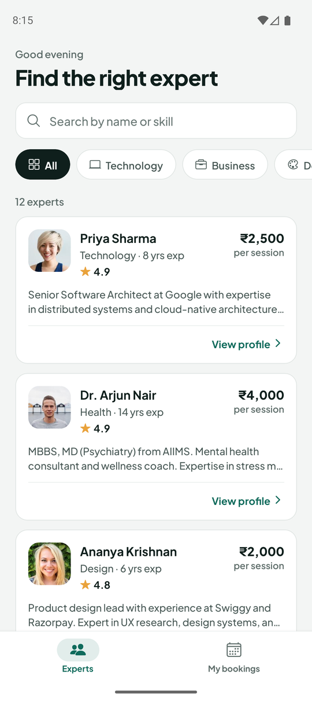
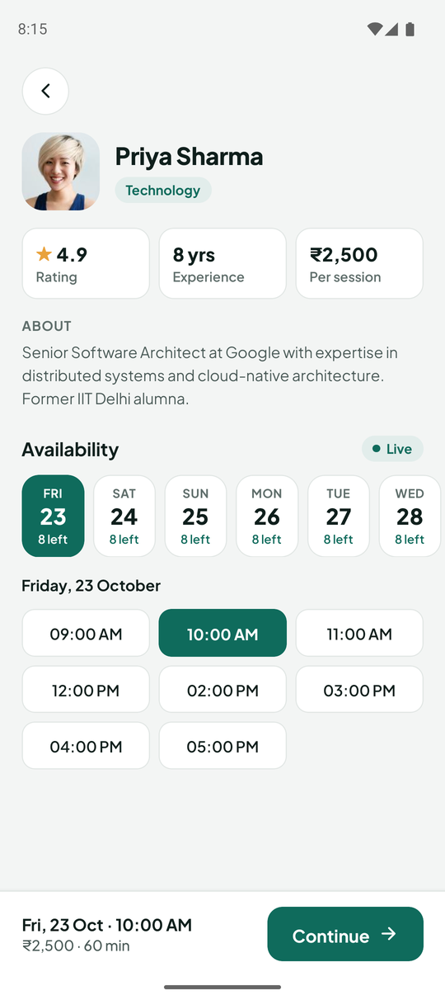
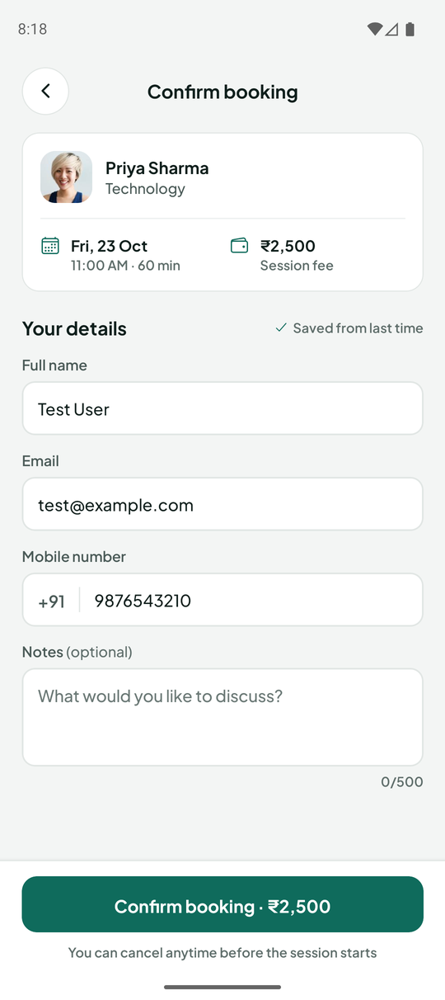
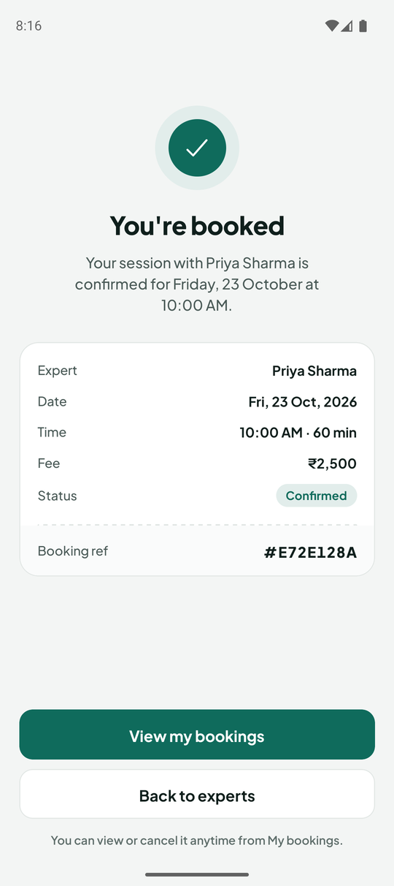
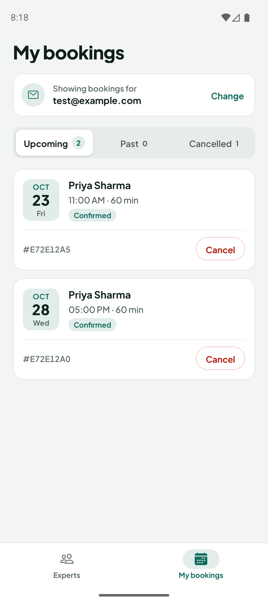

# Expert Session Booking System

Real-time expert session booking app built with **React Native (Expo SDK 54)** + **Node.js** + **Express** + **MongoDB** + **Socket.io**.

## Screenshots

<table>
  <tr>
    <td align="center"><br><sub>Find an expert</sub></td>
    <td align="center"><br><sub>Profile &amp; live availability</sub></td>
    <td align="center"><br><sub>Confirm booking</sub></td>
    <td align="center"><br><sub>Booked</sub></td>
    <td align="center"><br><sub>My bookings</sub></td>
  </tr>
</table>

<sub>Captured on an Android emulator (Pixel 9a) running in Expo Go.</sub>

## Features

- **Browse experts** — search by name or skill, filter by category, infinite scroll, pull to refresh
- **Live availability** — slots update in real time across devices; a status pill shows when the live connection drops, and the screen resyncs automatically when it comes back
- **Day-by-day slot picker** — pick a day (with "N left" / "Full" at a glance), then a time
- **Race-safe booking** — two people can never get the same slot; if someone takes yours while you're filling in the form, you're told immediately
- **Remembers you** — your name, email and phone are saved on the device, so the next booking is prefilled and My Bookings opens straight to your sessions
- **My Bookings** — Upcoming / Past / Cancelled tabs, cancel an upcoming session (the slot is released to everyone instantly), and "Book again"
- **Self-maintaining slots** — the server rolls availability forward every hour, so the app never runs out of slots after the seed date
- **Accessible design** — one consistent visual system (see [Design](#design)), 4.5:1 text contrast throughout, 44px touch targets

## Architecture

```
expert-booking-system/
├── backend/                      # Node.js + Express + MongoDB
│   ├── config/db.js              # MongoDB connection
│   ├── models/
│   │   ├── Expert.js             # Expert schema + slot sub-documents
│   │   └── Booking.js            # Booking schema + partial unique index
│   ├── controllers/
│   │   ├── expertController.js   # GET /experts, GET /experts/:id
│   │   └── bookingController.js  # create / list / cancel / status
│   ├── routes/                   # express-validator rules per endpoint
│   ├── middleware/errorHandler.js
│   ├── utils/slots.js            # Slot times, date helpers, hourly slot refresh
│   ├── server.js                 # Express + Socket.io entry point
│   ├── seed.js                   # 12 experts with 7 days of slots
│   └── .env.example
│
├── frontend/                     # React Native (Expo, React Navigation 7)
│   ├── App.js                    # Fonts, providers, root stack (tabs + booking flow)
│   └── src/
│       ├── screens/              # Experts, ExpertDetail, Booking, BookingSuccess, MyBookings
│       ├── components/UI.js      # Button, Avatar, Pill, FormField, empty/error states…
│       ├── context/ProfileContext.js  # Saved user details (AsyncStorage)
│       ├── hooks/useSlotUpdates.js    # Real-time slot events for one expert
│       ├── services/
│       │   ├── api.js            # Axios client, auto-detected backend URL
│       │   └── socket.js         # One shared Socket.io connection, ref-counted rooms
│       ├── utils/format.js       # Date / price / slot-time / initials helpers
│       └── constants/theme.js    # Design tokens: colors, type scale, radii, spacing
│
└── docs/screenshots/             # README images
```

## Setup & Run

### Prerequisites
- Node.js 18+
- MongoDB **replica set** — MongoDB Atlas (free tier is fine) works out of the box. Bookings use transactions, which a plain standalone `mongod` doesn't support; start a local one with `--replSet rs0` and run `rs.initiate()` once.
- Expo Go (SDK 54) on your phone, or an Android emulator / iOS simulator

### Backend

```bash
cd backend
npm install

cp .env.example .env      # then set MONGODB_URI

npm run seed              # 12 experts — also clears existing bookings
npm run dev               # development (nodemon)
npm start                 # production
```

The server runs at `http://localhost:5000`. On startup it syncs indexes and tops up slots for the next 7 days.

### Frontend

```bash
cd frontend
npm install
npx expo start
```

Scan the QR code with Expo Go (SDK 54). **No IP editing needed** — the app talks to the backend on the same computer that runs `expo start`, so it works on a phone on the same Wi-Fi and on emulators.

**Android emulator:** start an AVD from Android Studio's Device Manager, then press `a` in the `expo start` terminal (or run `npx expo start --android`).

To point at a different server (a deployed backend, or when using `expo start --tunnel`), create `frontend/.env`:

```env
EXPO_PUBLIC_API_URL=https://your-backend.example.com
```

Run `npm run doctor` in `frontend/` to check that dependencies match the Expo SDK.

---

## API Reference

| Method | Endpoint | Description |
|--------|----------|-------------|
| `GET` | `/experts` | List experts with pagination, search and category filter |
| `GET` | `/experts/:id` | Expert with upcoming (not yet started) slots |
| `POST` | `/bookings` | Create a booking (transactional, race-safe) |
| `GET` | `/bookings?email=` | Bookings for an email, newest first |
| `PATCH` | `/bookings/:id/cancel` | Cancel a booking — body `{ "email" }` must match the booking |
| `PATCH` | `/bookings/:id/status` | Admin/testing: change status (only valid transitions) |
| `GET` | `/health` | Health check |

### Query parameters for `GET /experts`

| Param | Type | Default | Description |
|-------|------|---------|-------------|
| `page` | number | 1 | Page number (min 1) |
| `limit` | number | 6 | Results per page (max 50) |
| `category` | string | - | Filter by category |
| `search` | string | - | Case-insensitive match on name or bio |

### `POST /bookings` body

```json
{
  "expertId": "...",
  "userName": "Chinmay Dubey",
  "email": "chinmay@example.com",
  "phone": "9876543210",
  "date": "2026-10-23",
  "timeSlot": "10:00 AM",
  "notes": "Want to discuss React Native architecture"
}
```

New bookings are `Confirmed` immediately — the slot is reserved atomically and there's no approval step.

### Status transitions

`Pending → Confirmed | Cancelled`, `Confirmed → Completed | Cancelled`. `Completed` and `Cancelled` are final: un-cancelling could re-activate a slot that someone else has since booked. Sessions can't be cancelled once they've started.

### Errors

| Status | When |
|--------|------|
| `400` | Malformed ID |
| `404` | Expert / booking not found (or email doesn't match on cancel) |
| `409` | Slot taken, slot already started, or invalid status change |
| `422` | Validation failed — `message` holds the first problem, `errors` lists all |

---

## Key Technical Decisions

### Double-booking prevention

Two layers:

1. **Transaction + optimistic lock** — the slot is claimed with a conditional update inside `session.withTransaction()`:
   ```js
   Expert.findOneAndUpdate(
     { _id: expertId, availableSlots: { $elemMatch: { date, time: timeSlot, isBooked: false } } },
     { $set: { "availableSlots.$.isBooked": true } },
     { session }
   )
   ```
   `$elemMatch` is essential: without it, `date`, `time` and `isBooked` can each match a *different* array element, and the positional `$` then updates the wrong slot. `withTransaction` automatically retries the write conflict that concurrent requests for the same expert produce, so losers get a clean `409` instead of a `500`.

2. **Partial unique index** — the final safety net on the Booking model:
   ```js
   bookingSchema.index(
     { expertId: 1, date: 1, timeSlot: 1 },
     { unique: true, partialFilterExpression: { status: { $in: ["Pending", "Confirmed", "Completed"] } } }
   )
   ```
   Partial so a cancelled booking doesn't block the freed slot from being rebooked. (Requires MongoDB 6.0+.)

### Real-time slot updates (Socket.io)

- The app keeps **one** socket connection. Screens join `expert_<id>` rooms through a ref-counted helper, so the profile and booking form can both listen without unsubscribing each other.
- Server emits `slot_booked` on booking and `slot_freed` on cancellation; screens update slots in place.
- After a reconnect (e.g. the app was in the background), rooms are rejoined and the profile refetches, because events sent while offline were missed.

### Slot lifecycle

Every expert offers the same hours (`utils/slots.js`). An hourly job removes past dates and appends any missing days up to 7 days ahead. `GET /experts/:id` hides slots that have already started, and `POST /bookings` rejects them. Slot times are interpreted in the server's timezone — set `TZ` (e.g. `Asia/Kolkata`) when hosting on a UTC server.

### Validation

- **Backend**: `express-validator` on every route (Mongo IDs, email, Indian mobile number, `HH:MM AM` slot format).
- **Frontend**: live field-level validation, then full validation on submit.

---

## Environment Variables

```env
PORT=5000
MONGODB_URI=mongodb://localhost:27017/expert-booking?replicaSet=rs0
CLIENT_URL=*            # CORS for browser clients only
NODE_ENV=development
TZ=Asia/Kolkata         # timezone for slot times
```

## Design

The UI follows one small visual system, "Pine & Porcelain". Every value lives in [`frontend/src/constants/theme.js`](frontend/src/constants/theme.js) — change it there, not in screens.

| Token | Value | Used for |
|-------|-------|----------|
| Accent | `#0F6B5C` pine | Primary buttons, selected slot/day, active tab |
| Accent tint | `#E2EDEB` | Pills, avatar fallback, active tab background |
| Ink | `#0F1F1C` | Headings, active filter chip |
| Text secondary / muted | `#4A5A57` / `#5F6E6B` | Body copy / labels (both ≥ 4.5:1 on white) |
| Ground / surface / line | `#F3F5F4` / `#FFFFFF` / `#E1E6E4` | Screen background, cards, hairline borders |
| Star | `#E9A23B` | Rating icon only (too light for text) |
| Danger | `#B42318` | Cancel actions, errors |

- **Type:** Plus Jakarta Sans (400–800), loaded with `expo-font`. Scale: display 28, title 22, heading 17, body 15, small 13, caption 12.
- **Shape:** radius 12 fields & slots, 14 buttons, 16 cards, pills fully rounded. Screen gutter 20.
- **Status pills:** Confirmed (pine), Pending (amber), Completed (slate), Cancelled (red) — each pairs a dark text color with a light tint.

## Troubleshooting

| Problem | Cause & fix |
|---------|-------------|
| Backend exits with `querySrv ENOTFOUND _mongodb._tcp.<cluster>.mongodb.net` | The Atlas cluster address in `backend/.env` doesn't exist (cluster deleted, paused, or string out of date). Copy a fresh connection string from Atlas → *Connect → Drivers*. |
| Backend errors with `Transaction numbers are only allowed on a replica set` | You're using a standalone local `mongod`. Use Atlas, or start `mongod --replSet rs0` and run `rs.initiate()` once. |
| App shows "Can't reach the server at http://…:5000" | The backend isn't running, or the phone isn't on the same Wi-Fi as your computer. Allow Node through the Windows firewall, or set `EXPO_PUBLIC_API_URL`. |
| Availability pill says "Reconnecting…" | The Socket.io connection dropped (e.g. backend restarted). It reconnects and refreshes slots automatically. |
| `npx expo start --android` stops at "Install the recommended Expo Go version?" | Answer the prompt in an interactive terminal, or update Expo Go on the device/emulator. |

## Known limitations

- There are no user accounts. Bookings are looked up by email, and cancelling requires the booking's email. That's a lightweight check, not real authentication.
- No emails are sent. Confirmation lives in the app (My Bookings).
